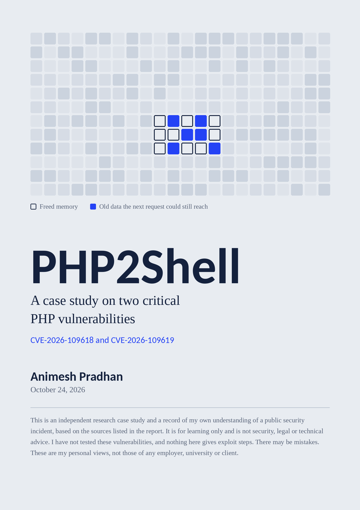

# PHP2Shell Case Study (2026)

A research case study on **PHP2Shell**, the nickname for two critical flaws in PHP itself: **CVE-2026-109618** and **CVE-2026-109619**. It covers what happened, why it matters, who is affected, and what to do. It is based entirely on public sources.

**Written by Animesh Pradhan** | Last updated: October 24, 2026

**[Read the full report (PDF)](PHP2Shell_casestudy.pdf)** | **[Official PHP advisory](https://www.php.net/archive/2026.php#2026-10-21-5)**

> **Note:** This incident was still developing when I wrote this. Check the official advisory for the latest details.

---

## The short version

### What happened
On October 20, 2026, details of two serious PHP flaws leaked before the patch was ready. PHP shipped emergency fixes on October 21, a day early. Researchers nicknamed the pair "PHP2Shell".

### What is it
Both bugs are in PHP's core, in how it handles memory between web requests.

- **CVE-2026-109618:** When PHP runs out of memory, some internal data can be left half set up, and the cleanup step then uses that bad data.
- **CVE-2026-109619:** A PHP worker can keep a reference to memory that was already freed, and a later request can use that stale leftover.

If an attacker can influence that data, the server can end up running their commands. This is a coding bug, not a backdoor.

### Why it is rated 9.2 (Critical)
- It works over the network.
- It needs no login and no click from anyone.
- Success can mean full control of the server.
- It is in PHP itself, so every PHP app on an unpatched server is exposed.

It is not easy to exploit on every platform, but attack attempts were reported within a day of the leak.

### What can happen
Stolen data and passwords, hijacked or defaced sites, hidden backdoors, and a way into other systems.

### Who is affected
Servers running PHP 5.4 or later that are not on a fixed version: **8.5.12, 8.4.27, 8.3.36 or 8.2.35 (or newer)**. PHP 8.1 and older get no official fix. Wiz estimates PHP runs about 70% of websites, though that does not mean all of them are vulnerable.

### My findings
- PHP is still everywhere because rewriting working sites is expensive.
- The flaw is in the platform, so updating WordPress or plugins alone does not fix it.
- Governments, hospitals and universities in Europe pulled sites offline as a precaution.
- I found no evidence that US federal websites were compromised or taken offline.

### What can be done
1. Find every PHP system you run, including containers and old test machines.
2. Update to a fixed PHP version. There is no complete workaround.
3. Use a firewall only as a temporary shield.
4. Watch for PHP starting unexpected processes, and for out-of-memory errors in logs.
5. For old unsupported versions, upgrade to a supported release. Until then, isolate the site or take it offline.

### AI cuts both ways
Researchers used AI to help find these bugs, which is good news for defenders. Wiz also noted that AI lowers the effort of turning a flaw into a working exploit. In the wrong hands, the same tools can shorten the time between a bug and an attack.

### The lesson
An easy-to-miss error-handling edge case, present in versions going back to PHP 5.4, ended up forcing public sites offline across Europe. Something small can cause something very big.

---

## Disclaimer

This is an independent research case study and a record of my own understanding of a public security incident. It is for learning and general information only.

- It is not professional security, legal or technical advice. Check the official PHP advisory and your own vendors, and speak to a qualified professional before making decisions about any system.
- I have not tested or reproduced these vulnerabilities. This repository contains no exploit code or attack steps, and I will not accept any.
- There may be mistakes. I accept no responsibility for actions taken based on this document.
- These are my personal views, not those of any employer, university, client or organisation.
- Names and trademarks belong to their owners. Mentioning a company or product is for reference only.
- Testing or scanning a system without permission may be illegal. Only test systems you own or have written authorisation to test.

Spotted a mistake? Please open an issue.

---

## Sources

Official:
- [PHP security announcement](https://www.php.net/archive/2026.php#2026-10-21-5)
- [GitHub advisory for CVE-2026-109618](https://github.com/php/php-src/security/advisories/GHSA-w8hw-w9fx-j79w)
- [GitHub advisory for CVE-2026-109619](https://github.com/php/php-src/security/advisories/GHSA-6wmf-4rv5-p3rp)

Reporting and analysis:
- [Vercel, php2shell security bulletin](https://vercel.com/kb/bulletin/php2shell-security-bulletin)
- [Picus Security, PHP2Shell explained](https://www.picussecurity.com/resource/php2shell-the-two-critical-php-rce-flaws-cve-2026-109618-cve-2026-109619-explained)
- [Tanium, responding to PHP2Shell](https://www.tanium.com/blog/php2shell-responding-to-cve-2026-109618-and-cve-2026-109619)
- [Huntress, rapid response](https://huntress.com/blog/php2shell-leaked-critical-php-vulnerabilities)
- [Dark Reading, PHP2Shell bugs](https://www.darkreading.com/application-security/php2shell-bugs-red-alert-security-industry)
- [Help Net Security, PHP2Shell patched](https://helpnetsecurity.com/2026/10/21/php2shell-php-vulnerabilities-patched-cve-2026-109618-cve-2026-109619)
- [Itdaily, exploited ahead of the patch](https://itdaily.com/blogs/software/php2shell-bug-php/)
- [PPC Land, Cloudflare blocks php2shell exploits](https://ppc.land/cloudflare-blocks-php2shell-exploits-9-hours-before-php-flaws-went-public/)
- [The Next Web, European governments pull websites offline](https://thenextweb.com/news/europe-governments-websites-offline-php-security-flaws)
- [Newsweek, PHP vulnerability coverage](https://www.newsweek.com/php-vunerability-php2shell-issue-websites-hack-server-12601225)
- [blue News, php2shell security vulnerability](https://www.bluewin.ch/en/digital/security-vulnerability-threatens-millions-of-websites-what-does-that-mean-li.3643831)
- [Level Up Coding, how to patch PHP2Shell](https://levelup.gitconnected.com/php2shell-two-critical-php-flaws-are-being-exploited-heres-how-to-patch-today-add61aa15d10)
- [SmartScope, who found PHP2Shell and the AI role](https://smartscope.blog/en/blog/php2shell-ai-really-find-php-vulnerability-roles-openai-2026/)
- [Health-ISAC bulletin](https://www.aha.org/system/files/media/file/2026/10/h-isac-vulnerability-bulletins-tlp-white-two-critical-remote-code-execution-vulnerabilities-in-php-cve-2026-109618-cve-2026-109619-10-21-2026.pdf)

---

## Updates

- **October 24, 2026:** First version published.
